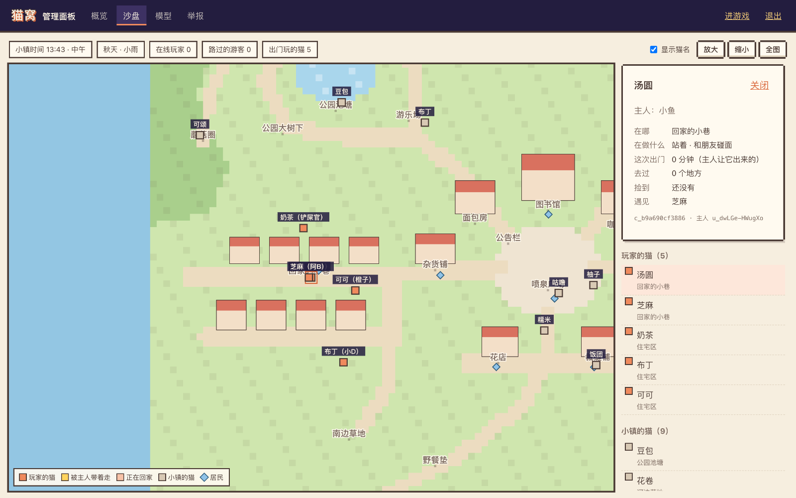

# 猫窝 · 服务器部署手册

用一台 Linux 服务器 + Docker 上线猫窝。整套服务是两个容器：

- **app**：游戏本体（网页、接口、实时小镇、数据库都在里面）
- **caddy**：对外的 HTTPS 入口，自动申请并续期证书

数据（数据库、密钥、每日备份）都在 Docker 卷里，重启、更新、重建容器都不会丢。

---

## 0. 准备

| 项目 | 要求 |
|---|---|
| 服务器 | Linux（Ubuntu 22.04/24.04、Debian 12、Rocky 9 等都可以），x86_64 或 ARM64 |
| 配置 | 起步 1 核 2G。只有 1G 内存的话，请用预构建镜像包（见第 6 节），或者先加 swap |
| 域名 | 一个域名（或子域名，例如 `cat.example.com`），**A 记录指向服务器公网 IP** |
| 端口 | 防火墙 / 云服务器安全组放行 **80/TCP、443/TCP、443/UDP** |

> **国内服务器请注意**：阿里云、腾讯云、华为云等国内机房要求域名完成 **ICP 备案** 才能使用 80/443 端口，否则 Caddy 申请不到证书、网站也打不开。境外服务器（香港、新加坡、日本等）不需要备案。

---

## 1. 上传并解压

在你自己的电脑上，把压缩包传到服务器（以 `/opt` 为例）：

```bash
scp catnest-2026-10-15k.tar.gz root@你的服务器IP:/opt/
```

登录服务器后解压：

```bash
cd /opt && tar xzf catnest-2026-10-15k.tar.gz && cd catnest
```

## 2. 安装 Docker

已经装过可以跳过。

Debian 13 / Ubuntu 24.04 以上直接用系统自带的软件包（实测 Debian 13 可用）：

```bash
apt-get update && apt-get install -y docker.io docker-cli docker-compose
```

其他系统的境外服务器：

```bash
curl -fsSL https://get.docker.com | sh
```

国内服务器（用阿里云镜像安装）：

```bash
curl -fsSL https://get.docker.com | sh -s -- --mirror Aliyun
```

确认版本（Compose 需要 v2.24 以上）：

```bash
docker compose version
```

## 3. 一键部署

把 `cat.example.com` 换成你的域名：

```bash
./deploy/setup.sh cat.example.com
```

脚本会自动：

1. 生成 `.env`（填好域名，随机生成管理口令，权限设为仅 root 可读）；
2. 构建镜像并启动两个容器（第一次需要几分钟）；
3. 等游戏服务健康检查通过后告诉你结果。

然后等几十秒让 Caddy 申请证书，用浏览器打开 `https://你的域名`，能看到游戏官网就成功了；游戏本身在 `https://你的域名/play/`。

<details>
<summary>不想用脚本？手动部署的步骤</summary>

```bash
cp .env.example .env
```

编辑 `.env`，至少把 `CAT_DOMAIN` 改成你的域名，`CAT_ADMIN_TOKEN` 填一串随机字符（可以用 `openssl rand -hex 24` 生成），然后：

```bash
chmod 600 .env && docker compose up -d --build
```

</details>

## 4. 检查是否正常

```bash
docker compose ps
```

两个容器都应是 `Up`，其中 app 显示 `(healthy)`。

```bash
curl -s https://你的域名/healthz
```

返回 `ok` 就说明 HTTPS、反向代理和游戏服务都通了。

查看日志：

```bash
docker compose logs -f
```

## 5. 可选配置（都在 `.env` 里）

| 变量 | 作用 |
|---|---|
| `CAT_ALIASES` | 其他也指向这台服务器的域名（如 `www.你的域名`），会自动跳转到主域名；多个用空格隔开 |
| `CAT_WORLD_TZ` | 小镇的统一时钟，默认 `8`（北京时间） |
| `ANTHROPIC_API_KEY` | 填写后猫猫的话由 Claude 生成；不填则用内置的句子，游戏完全可玩 |
| `CAT_LLM_MODEL` | 默认 `claude-opus-5-5`；想省钱可换 `claude-haiku-5-5` |
| `CAT_LLM_DAILY` / `CAT_LLM_USER_DAILY` | 全服每天、每位玩家每天的模型调用上限 |
| `NPM_REGISTRY` | 构建时的 npm 源，国内服务器可设为 `https://registry.npmmirror.com` |
| `CAT_APNS_*` | iOS App 推送（有 Apple 开发者账号后再配置，见 [docs/apps.md](docs/apps.md#上架-testflight--app-store-前)） |

改完 `.env` 后让它生效：

```bash
docker compose up -d
```

## 6. 国内服务器下载慢 / 内存小

**方法一：换源。** 在 `.env` 里加上 `NPM_REGISTRY=https://registry.npmmirror.com`。如果拉取 Docker 基础镜像也很慢，可以在 `/etc/docker/daemon.json` 里配置你所用云厂商提供的镜像加速地址，然后重启 Docker。

**方法二：用预构建镜像包。** 如果拿到了 `catnest-images-amd64-*.tar.gz`（已经编译好的游戏镜像和 Caddy 镜像，适用于 x86_64 服务器），把它和项目放在同一目录（`/opt/catnest/` 或 `/opt/`），再运行 `./deploy/setup.sh 你的域名`。脚本会直接导入镜像，服务器上不需要联网下载依赖，也不需要编译，1G 内存也够用。

## 7. 日常运维

### 管理面板



打开 `https://你的域名/admin/`，输入 `.env` 里的 `CAT_ADMIN_TOKEN` 登录（在这台电脑上保持一天）。忘了口令可以在服务器上查：

```bash
grep CAT_ADMIN_TOKEN /opt/catnest/.env
```

面板有五页：

**概览**：在线玩家（以及今天最多同时在线几人）、路过看小镇的游客、出门玩的猫、注册 / 今天来过 / 今天新来的玩家、给猫窝上了锁的账号、待处理的举报；最近两周每天新来、来过和同时在线人数的趋势图；服务器运行时长、内存、数据库大小，以及今天模型的调用情况。每 15 秒自动刷新。“来过”和“同时在线”从开启面板那天起按天记录，更早的日子只有新玩家数。

**沙盘**：整个小镇的像素地图，每 2 秒刷新一次，猫和居民在两次刷新之间平滑地走动。

- 不同颜色区分：玩家的猫（珊瑚色）、正被主人带着走的猫（黄色）、正在回家的猫（浅粉）、小镇自己的猫（米灰色，没有主人）、居民（蓝色菱形）。
- 顶部显示小镇时间、季节天气、在线玩家、路过的游客和出门玩的猫。
- 滚轮或「放大 / 缩小」缩放，拖动平移，「全图」回到整个小镇；「显示猫名」可以关掉猫名标签。
- 点地图上的一只猫（或右边名单里的名字）：能看到它的主人、在哪、在做什么、要去哪（地图上的虚线）、这次出门多久、去过几个地方、捡到了什么、遇见了谁。从名单里点的猫，镜头会一直跟着它，拖一下地图就停止跟随。

**玩家**：小镇里所有铲屎官的名册，一人一行，带着各自的猫。

- 可以按称呼、猫的名字或 ID 搜索；筛选「今天来过 / 这周来过 / 新来的 / 猫窝上了锁 / 暂停中」（旁边是人数）；按最近来过、最新加入或称呼排序；每页 30 位。
- 点一位玩家，从右边打开 ta 的小页面：每只猫的样子、年龄、心情、饱腹 / 精力 / 心情、在哪、去过几个地方、羁绊、和谁一起养；账号有没有上锁、登录着几台设备、通知开没开、小鱼干、背包和收藏册。只有照顾小镇需要的信息，看不到交换日记和纸条的内容，也看不到找回码。
- 能做的事都很温和：**寄一封小纸条**（以小镇的名义寄到 ta 的信箱，可以附上 50 / 100 / 200 小鱼干，在线的话 ta 会马上看到）；猫的名字不合适时**帮它改个名**；最后才是页面最下面的**暂停账号**，要写原因，暂停后 ta 会退出登录、猫回到窝里、暂停期间不出现在小镇和串门列表里，随时可以恢复，数据都还在。没有删除账号的按钮（玩家可以在游戏设置里自己删除）。
- **测试工具**收在名册最下面，默认折叠：输入猫的名字或 ID，给自己的测试账号解锁全部内容——商店里所有东西放进背包（家具和墙饰各 3 件，衣服、墙纸、地板各 1 件，零食各 20 份）、收藏册集满、小镇全部地点都算去过、小鱼干补到 9999；不改变猫的年龄和羁绊，做了不能撤回，重新打开游戏就能看到。

**模型**：

- 「开启」开关：打开后猫说的话、猫和猫的对话、居民闲聊、探险日记和小纸条由模型生成；关闭或没有 Key 时用内置的句子，游戏照样完整可玩。
- API Key：面板里只显示开头和结尾几位；Key 保存在服务器的数据库里。「改回使用 .env 里的 Key」可以撤销面板里填的 Key。
- 模型：Claude Opus 5.5（默认）、Sonnet 5.5、Haiku 5.5、Fable 5.1，或「其他模型」。**兼容 Anthropic API 的其他服务（比如 MiniMax）也可以用**：选「其他模型」，填服务商的模型 ID，在「API 地址」里填服务商文档里写的 Anthropic 兼容接口地址。这类模型不支持 Claude 的结构化输出，游戏会在提示词里说明要的格式，并宽容地读取回答；回答格式不对时，这一句改用内置句子，不会卡住。
- 其他模型可以填上每百万 tokens 的输入 / 输出价格（人民币或美元），面板就能估算花费；Claude 模型按官网标价自动估算。
- 思考力度（effort）只对 Claude 生效；还可以设置全服每分钟、全服每天、每位玩家每天的调用上限，超过后猫猫改用内置句子。
- 「用这些设置试一句」会用正在编辑、还没保存的设置真实调用一次模型，确认能用再「保存设置」。保存后马上生效，不用重启。
- 下方是今天的调用次数（成功 / 失败）、输入输出 tokens、平均耗时、估算花费，以及最近一次出错的原因。服务器重启后当天的用量从零开始算。

**举报**：玩家举报的猫名、纸条和交换日记，可以标记为处理完；情节严重的，可以暂停作者的账号（ta 会退出登录，以后可以在「玩家」里恢复）。

面板里保存的模型设置会覆盖 `.env` 里的同名配置；点「恢复 .env 默认」就回到 `.env`。没有设置 `CAT_ADMIN_TOKEN` 时管理面板是关闭的。

安全方面：没登录时所有管理接口都返回 404；登录后的凭证只在 `/api/admin` 下有效、一天后过期；登录和「试一句」都有频率限制；页面不会被搜索引擎收录。

### 命令行

所有命令都在项目目录（例如 `/opt/catnest`）里执行。

| 做什么 | 命令 |
|---|---|
| 看日志 | `docker compose logs -f app` |
| 看在线、注册等统计 | `docker compose exec app node scripts/admin.mjs stats` |
| 看举报 | `docker compose exec app node scripts/admin.mjs reports` |
| 处理完一条举报 | `docker compose exec app node scripts/admin.mjs resolve <编号>` |
| 封禁（可以填用户 ID 或猫 ID） | `docker compose exec app node scripts/admin.mjs ban <ID> 原因` |
| 解封 | `docker compose exec app node scripts/admin.mjs unban <用户ID>` |
| 给不合适的猫改名 | `docker compose exec app node scripts/admin.mjs rename-cat <猫ID> 新名字` |
| 删除纸条 / 交换日记 | `docker compose exec app node scripts/admin.mjs delete-note <编号>`（日记用 `delete-diary`） |
| 重启 | `docker compose restart` |
| 停止 | `docker compose down`（数据不会丢） |

**追加屏蔽词**：写一个 `blocklist.txt`（一行一个词），复制进去，立即生效：

```bash
docker compose cp blocklist.txt app:/app/data/blocklist.txt
```

## 8. 备份与恢复

服务每天自动在数据卷里做一份数据库快照（`backups/cats-日期.db`），保留最近 7 天。建议定期再拷到服务器之外：

```bash
docker compose cp app:/app/data/backups ./catnest-backups
```

**完整打包整个数据卷**（迁移服务器时用）。卷名一般是「目录名_catnest-data」，可以用 `docker volume ls` 确认：

```bash
docker run --rm -v catnest_catnest-data:/d -v "$PWD":/b alpine tar czf /b/catnest-data.tgz -C /d .
```

**在新服务器上恢复**：先按第 1～3 步部署一遍，然后：

```bash
docker compose down
```

```bash
docker run --rm -v catnest_catnest-data:/d -v "$PWD":/b alpine sh -c "rm -rf /d/* && tar xzf /b/catnest-data.tgz -C /d && chown -R 1000:1000 /d"
```

```bash
docker compose up -d
```

> 数据卷里的 `secret.json` 用来校验找回码，`vapid.json` 用于网页推送。迁移时必须连同数据库一起搬，否则玩家的找回码会失效、通知需要重新开启。

## 9. 更新到新版本

把新的压缩包传到服务器，解压**覆盖**原目录（`.env` 和数据不在压缩包里，不会被覆盖），然后重新运行脚本：

```bash
cd /opt && tar xzf catnest-新版本.tar.gz && cd catnest && ./deploy/setup.sh
```

## 10. 常见问题

**打不开网站 / 证书申请失败**：查看 `docker compose logs caddy`。常见原因有：DNS 还没生效（`ping 你的域名` 看解析出的 IP 对不对）；安全组没放行 80/443；国内服务器的域名没有备案。

**80/443 已被占用**（服务器上已经有 Nginx 等）：二选一。
- 停掉原来的服务，让 Caddy 接管；
- 删掉 `docker-compose.yml` 里的 `caddy` 服务，给 `app` 加上 `ports: ["127.0.0.1:8737:8737"]`，由你现有的反向代理转发到 `127.0.0.1:8737`。注意要支持 WebSocket（路径 `/ws`，转发 `Upgrade` / `Connection` 头），并传递 `Host`、`X-Forwarded-For`、`X-Forwarded-Proto`。

**构建时卡住或报内存不足**：用第 6 节的预构建镜像包，或者给服务器加 2G swap 后再构建：

```bash
fallocate -l 2G /swapfile && chmod 600 /swapfile && mkswap /swapfile && swapon /swapfile
```

**页面能打开但小镇连不上**：通常是自己加的反向代理没有转发 WebSocket，见上面「80/443 已被占用」。

## 11. 让各个 App 连到你的服务器

服务器上线后，各客户端需要知道你的域名：

| 客户端 | 在哪里改 |
|---|---|
| 网页版 | 不用改：官网是 `https://你的域名`，游戏在 `https://你的域名/play/` |
| iPhone App | 项目根目录的 `.env.ios` 里写 `VITE_API_BASE=https://你的域名`，再 `npm run build:ios` |
| Mac App | `macos/project.yml` 里 Release 的 `CATNEST_SERVER`；装好的 App 也可以执行 `defaults write com.catnest.mac serverURL https://你的域名` |
| Apple Watch | `ios/App/CatNestWatch/Config.swift` 里的 `defaultServer`；和 iPhone 配对使用时会自动跟随手机 |
| Android App | 项目根目录的 `.env.android` 里写 `VITE_API_BASE=https://你的域名`，再 `npm run build:android` 并重新打包（见 [docs/apps.md](docs/apps.md#打正式包)） |

### 发布 Android 安装包

官网的「下载 APK」按钮指向 `/download/meowtopia.apk`。这个文件不在 git 和镜像里，由 Caddy 直接从服务器上的 `/opt/catnest/downloads/` 目录提供，所以换新版本不需要重新部署。

1. 按 [docs/apps.md「打正式包」](docs/apps.md#打正式包) 打出签名好的 APK（要连你自己的服务器，先在 `.env.android` 里写好你的域名）。
2. 在电脑上，把它和版本说明一起传到服务器（官网的下载卡片会显示版本、大小和 SHA-256 校验值）：

```bash
./deploy/publish-apk.sh android/app/build/outputs/apk/release/app-release.apk 1.0 root@你的服务器IP:/opt/catnest
```

以后发新版本，把版本号（`android/app/build.gradle` 里的 `versionCode` 加 1、`versionName` 改新）改好后重新打包、再运行一次这条命令即可。已经装了旧版的玩家直接覆盖安装，猫和登录都还在。

## 12. 安全提醒

- `.env` 里有管理口令，保持 `chmod 600`，不要提交或发给别人。
- 不要把 8737 端口直接暴露到公网，所有流量都应经过 Caddy。
- 游戏容器以非 root、只读文件系统运行，只有数据卷可写。
- 服务器本身记得开启自动安全更新，只开放 SSH、80、443 端口。

### 服务器加固（可选）

`deploy/harden.sh` 是给 Debian 服务器准备的加固脚本：补上安全更新源（有些服务商的系统镜像没有带）并开启自动安全更新、保存系统日志、加上防火墙、把 SSH 换到高端口等。分两步运行，新端口没确认前会自动撤销，不会把自己锁在门外。做了什么、怎么用都写在脚本开头，按自己的习惯取舍。
