<p align="center">
  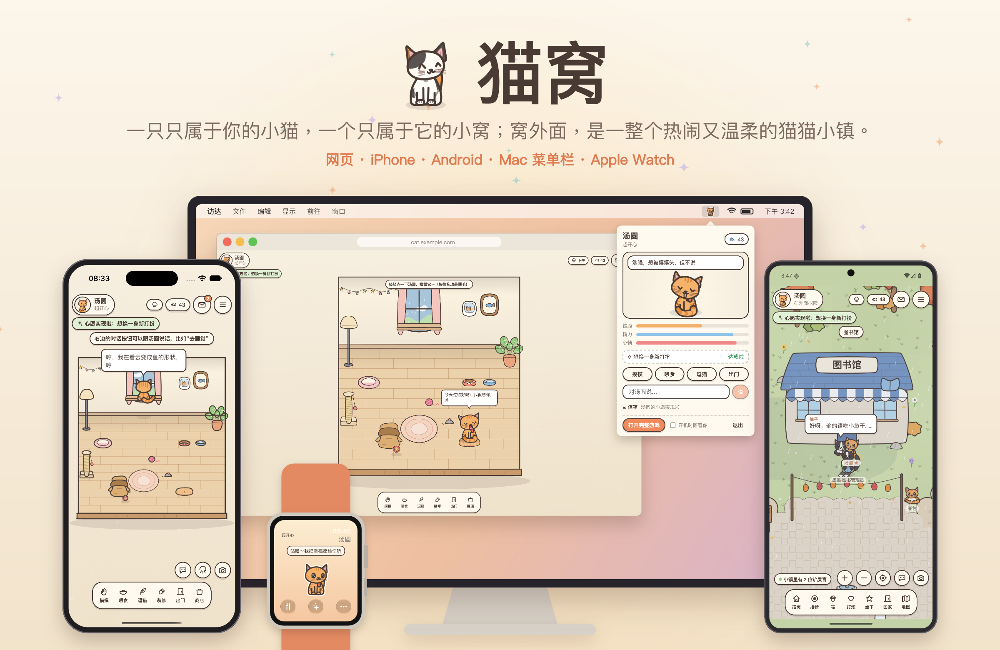
</p>

<p align="center">
  
  
  
  
  
  
  
  <a href="#开源协议"></a>
</p>

<p align="center">
  <a href="https://mycat.xioix.xin"><b>🏠 官网</b></a> ·
  <a href="https://mycat.xioix.xin/play/"><b>▶ 网页版，马上玩</b></a> ·
  <a href="https://mycat.xioix.xin/download/meowtopia.apk"><b>⬇ Android 安装包</b></a> ·
  <a href="docs/apps.md#ios-app"><b>iPhone：用 Xcode 安装</b></a>
</p>

<p align="center">
  <a href="#在哪里都能陪着你">五个客户端</a> ·
  <a href="#它是怎样的游戏">玩法</a> ·
  <a href="#五分钟跑起来">本地运行</a> ·
  <a href="#放到自己的服务器上">部署上线</a> ·
  <a href="docs/apps.md">客户端构建</a> ·
  <a href="docs/development.md">开发者文档</a> ·
  <a href="#开源协议">开源协议</a>
</p>

<br>

这是一款**不催你**的养猫游戏。

你的猫有自己的性格和生活：白天趴在窗台上看云，傍晚在屋里跑酷，你不在的时候自己出门探险、交朋友、捡回小宝贝，天黑之前一定回家。你什么时候打开，它都在那里。

> **没有一张图片素材。** 猫、家具、小镇、居民、图标，全部是代码实时“手绘”的线条画，线条还会像手绘动画一样轻轻呼吸。下面每一张截图都来自真实运行的游戏。

<br>

## 在哪里都能陪着你

同一只猫、同一个账号，在五个地方陪着你。在一处摸摸它，另一处它也会记得。

### 网页

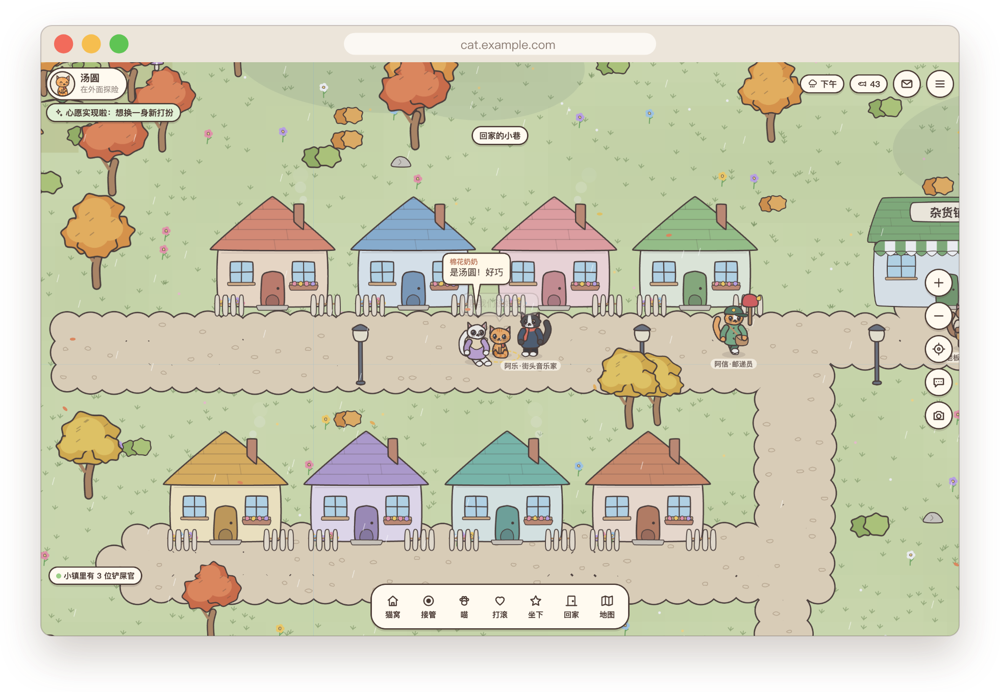

**打开浏览器就能玩，什么都不用装。** 电脑上画面最大，小镇一眼能看得很远；手机浏览器里可以「添加到主屏幕」，像 App 一样全屏打开，也能收到它的小纸条（Web Push）。

<br>

<table>
<tr>
<td width="50%" valign="top" align="center">
  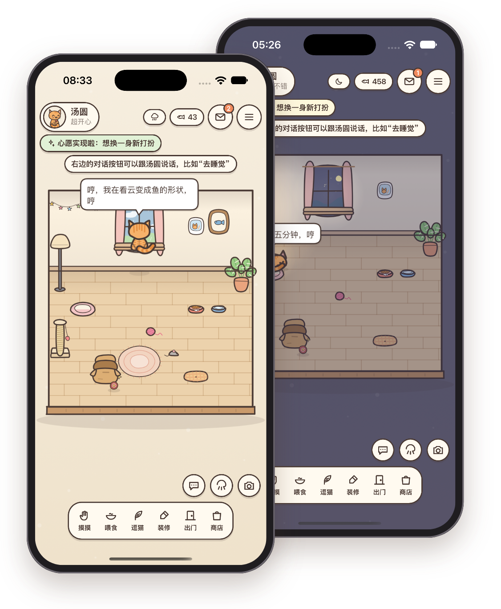
  <h3>iPhone</h3>
  <p align="left">白天它趴在窗台上看“云变成鱼的形状”，夜里蜷在小床上说梦话。</p>
  <ul align="left">
    <li>登录凭证存在钥匙串里，删了重装也还在</li>
    <li>小纸条走苹果推送，点开直接进信箱</li>
    <li>呼噜、发现宝贝时手里会轻轻一震</li>
    <li>自动把登录交给配对的 Apple Watch</li>
  </ul>
</td>
<td width="50%" valign="top" align="center">
  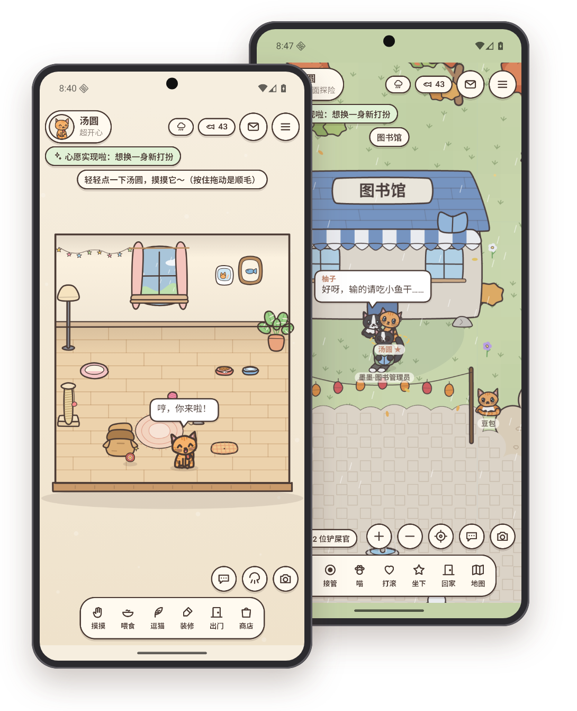
  <h3>Android</h3>
  <p align="left">和 iPhone 版完全一样的游戏，按安卓的习惯重新打磨过。</p>
  <ul align="left">
    <li><b>通知不依赖谷歌服务</b>，国内手机也能收到</li>
    <li>返回键一层层退，不会一下子退出</li>
    <li>照片直接存进相册「猫窝」</li>
    <li>状态栏跟着昼夜和场景变色，支持主题图标</li>
  </ul>
</td>
</tr>
</table>

<table>
<tr>
<td width="58%" valign="middle">
  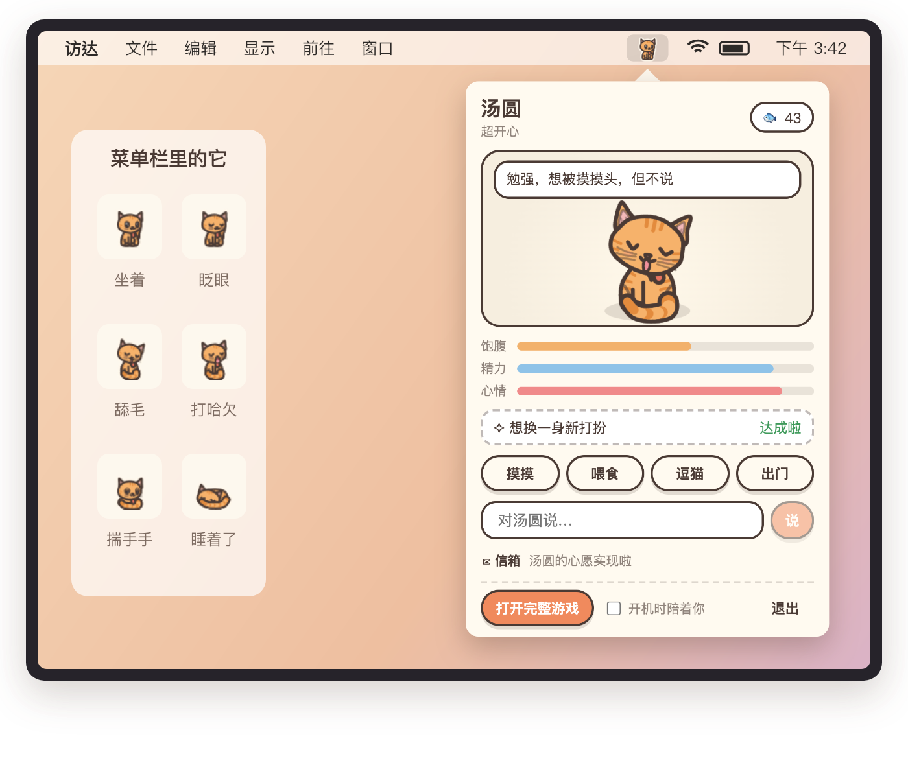
</td>
<td width="42%" valign="middle">
  <h3>Mac 菜单栏</h3>
  <p><b>你的猫常驻在屏幕右上角。</b>它会眨眼、甩尾巴、舔毛、打哈欠，晚上蜷成一团睡觉，出门探险时变成一串小爪印。</p>
  <p>点一下就是陪伴面板：摸摸、喂食、逗猫、叫它出门或回家，也能直接打字对它说话。想认真玩的时候，「打开完整游戏」就是一个独立窗口。</p>
</td>
</tr>
<tr>
<td width="42%" valign="middle">
  <h3>Apple Watch</h3>
  <p><b>抬起手腕，它就在那里。</b>轻点是摸摸，转动表冠是顺毛：每顺一下手腕轻轻一震，顺够了会冒出小爱心，还能感觉到它呼噜呼噜。</p>
  <p>可以喂食、逗猫、出门、看信、用语音对它说话。手表可以完全脱离手机使用，甚至直接在手表上领养一只。</p>
</td>
<td width="58%" valign="middle" align="center">
  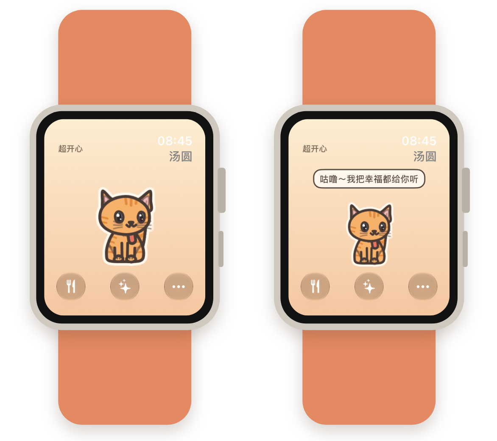
</td>
</tr>
</table>

<br>

## 它是怎样的游戏

### 每一只猫都独一无二

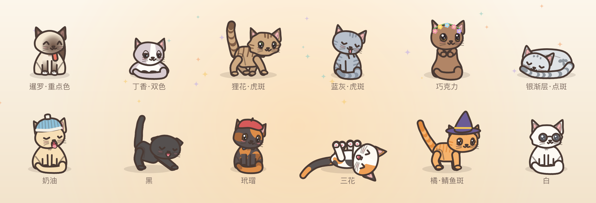

领养的时候，小猫由一组「基因」随机长成：**12 种毛色 × 9 种花纹**，再加上眼睛颜色（偶尔是异瞳）、耳朵大小、折耳、尾巴长短、胖瘦、长毛。它还有自己的性格、说话风格和小癖好，大约两周里从小奶猫慢慢长大。

它有 6 种视角、30 多种动作：踩奶、舔毛、伸懒腰、蹲纸箱、上爬架、追毛线球、傍晚跑酷、半夜团成一颗团子。上面这十二只，每一只都是代码画出来的。

<table>
<tr>
<td width="33%" align="center">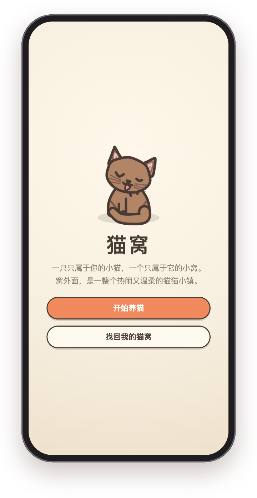<br><sub><b>第一次打开</b><br>起个称呼，从一窝小奶猫里挑一只带回家</sub></td>
<td width="33%" align="center">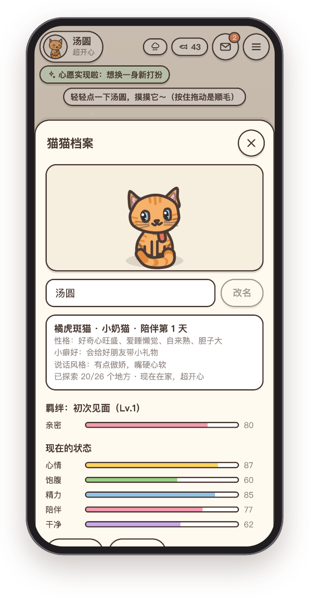<br><sub><b>猫猫档案</b><br>性格、喜好、说话风格，和你们的羁绊</sub></td>
<td width="33%" align="center">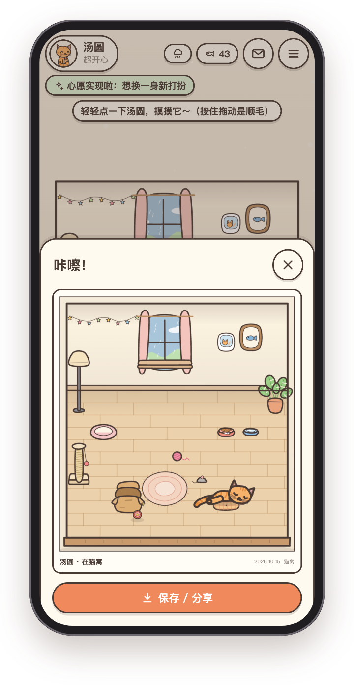<br><sub><b>咔嚓</b><br>随手把它拍成一张拍立得</sub></td>
</tr>
</table>

### 它的小窝，跟着你的时间过日子

小窝里的一天和你的一天同步：早上阳光从窗户斜斜照进来，下雨天窗上挂着雨丝，晚上落地灯和星星灯亮起来。它按时间、心情、性格和家里的家具决定做什么。

你可以摸摸（点按）、顺毛（拖动）、喂零食、拿羽毛逗猫棒逗它（举高了它会站起来抓），叫它过来，或者直接对它说「去睡觉」「去河边看看」。每天它会有一个小心愿，实现了会很开心，没实现也没关系。晚上说一声「晚安」，它会去最喜欢的床，踩踩奶，打个哈欠，团成一团睡着。

<table>
<tr>
<td width="33%" align="center">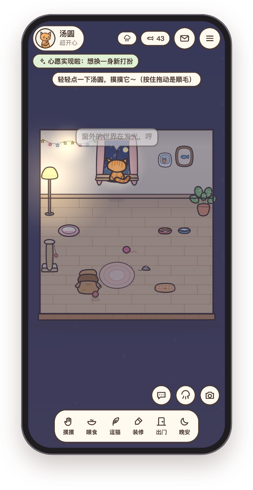<br><sub><b>夜里</b><br>星星灯亮着，它在窗台上看月亮</sub></td>
<td width="33%" align="center">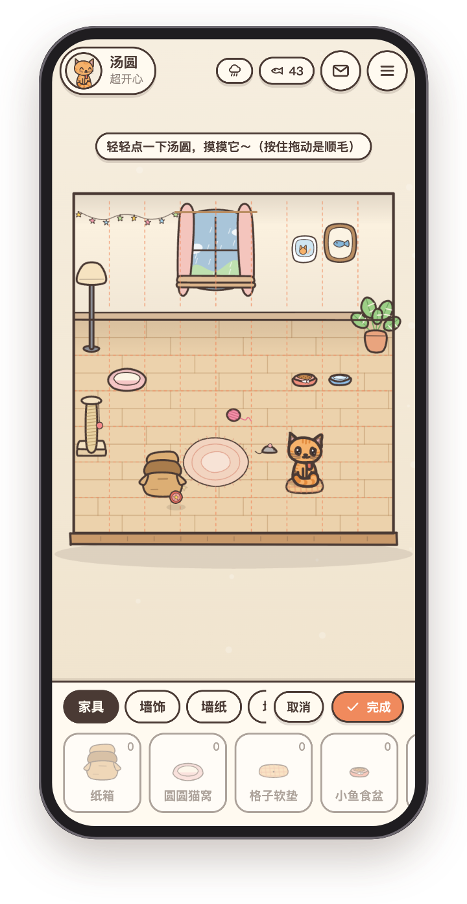<br><sub><b>装修</b><br>27 种家具、墙饰、墙纸和地板，随手摆</sub></td>
<td width="33%" align="center">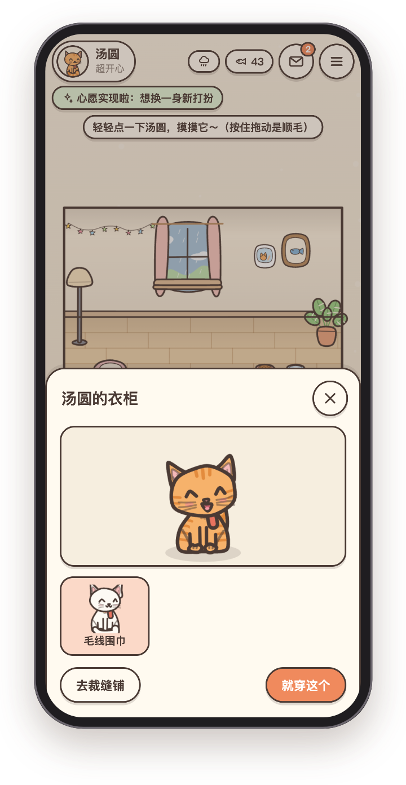<br><sub><b>衣柜</b><br>围巾、贝雷帽、花冠……13 种小装扮</sub></td>
</tr>
</table>

### 窝外面，是一整个小镇

一张 120×90 格的大地图：喷泉广场、面包房、咖啡馆、图书馆、邮局、花店、裁缝铺、公园池塘、森林、小河与木桥、花田风车、山顶大树、沙滩和灯塔。

**13 位猫猫居民按自己的作息过日子**：面包房老板娘清晨揉面，邮递员阿信挨家送信，棉花奶奶在巷口织毛线，阿乐傍晚在喷泉边弹琴，图书管理员墨墨守着图书馆，深夜还有阿月的热羊奶摊。所有玩家的猫都在同一个小镇里，会在路上碰鼻子、交朋友。

你可以看它自己逛，也可以「接管」亲自带着它走，点别的猫或居民去打个招呼。小镇有实时的昼夜、雨雪和四季：春天的樱花，秋天的枫叶，冬天的雪顶和猫耳雪人。

<table>
<tr>
<td width="33%" align="center">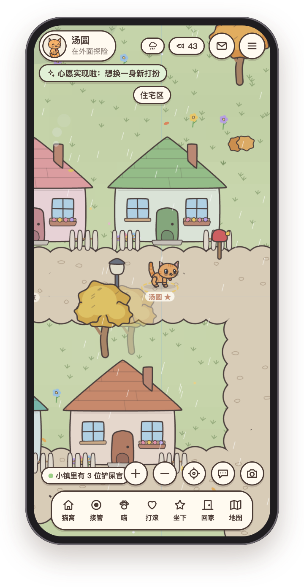<br><sub><b>出门探险</b><br>它会自己逛，捡回 32 种按季节出现的宝贝</sub></td>
<td width="33%" align="center">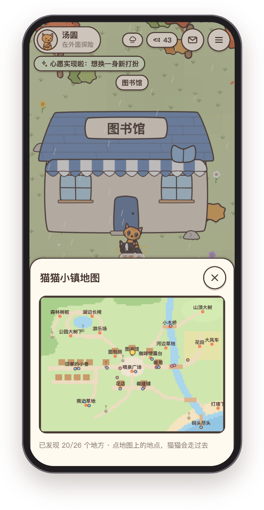<br><sub><b>小镇地图</b><br>26 个地方，点一下它就走过去</sub></td>
<td width="33%" align="center">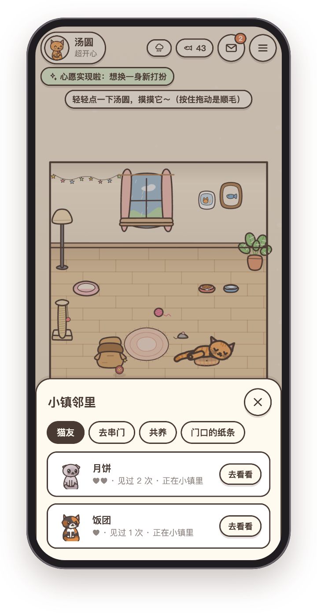<br><sub><b>邻里</b><br>猫友是它自己交的；可以串门、贴纸条、共养</sub></td>
</tr>
</table>

### 它会说话，也会给你写信

配置了 Claude 的 API key 之后，猫说的话、猫与猫之间的对话、居民的闲聊、探险日记和通知文案，都会结合它的性格、记忆、时间、天气和地点实时生成。没有 key 也没关系，内置的语句生成器能让游戏完全可玩。

你不在的时候，它的经历会变成信箱里的小纸条和一本日记。在外面捡到的宝贝，会被郑重地摆进收藏柜。

<table>
<tr>
<td width="33%" align="center">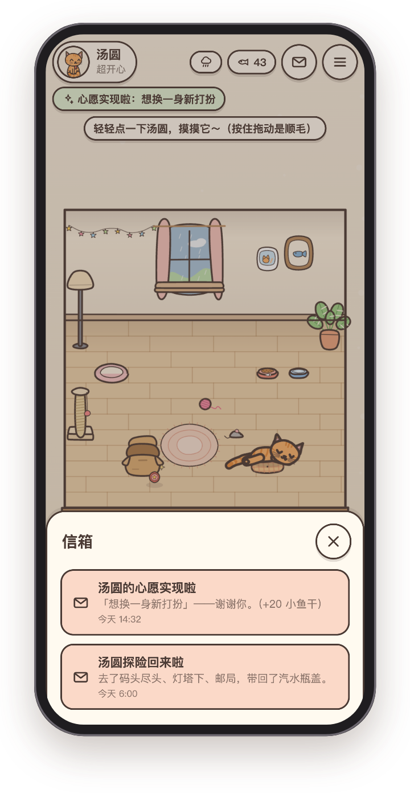<br><sub><b>信箱</b><br>探险回来、心愿实现，它都会写信告诉你</sub></td>
<td width="33%" align="center">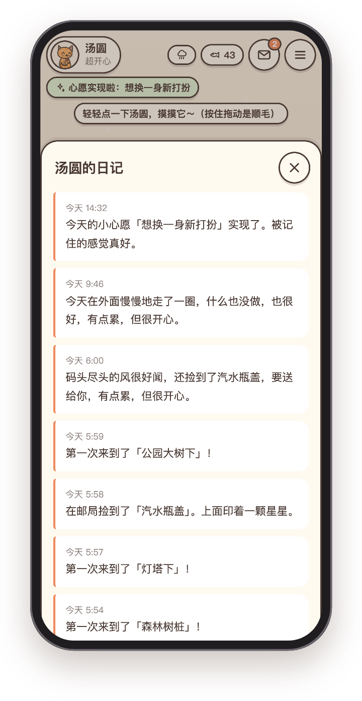<br><sub><b>日记</b><br>它的每一天，第一次去过的地方</sub></td>
<td width="33%" align="center">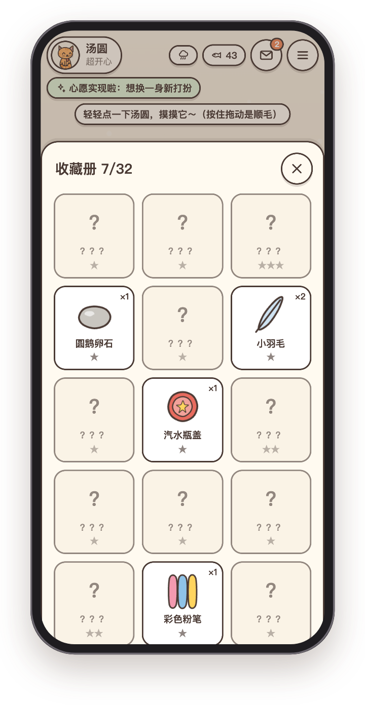<br><sub><b>收藏册</b><br>鹅卵石、羽毛、汽水瓶盖……</sub></td>
</tr>
</table>

### 不制造焦虑

- 没有连续签到、好友数、点赞、排行榜、在线状态和已读回执。
- 它不会饿坏：食盆里一直有猫粮，一周没人管也过得好好的，零食只是额外的小幸福。
- 通知一天最多 4 条，有安静时段，从不说“你好久没来了”。
- 「共养」可以和一位陌生人一起养一只新的小猫，你们之间只有一本每天一页的交换日记。
- 名字、纸条和日记都会过滤联系方式、链接和不友善的话。

<br>

## 账号与隐私

- **不需要邮箱，也不需要手机号。** 第一次打开起个称呼就能玩；之后可以绑定通行密钥（面容 / 指纹），或者生成一串 12 位的找回码，换手机也能把猫领回来。
- **数据在你自己的服务器上。** 设置里可以导出全部数据，也可以删除账号。
- 安全设计（会话、CSRF、限流、工作量证明、CSP 等）见 [开发者文档 · 账号与安全](docs/development.md#账号与安全)。

## 五分钟跑起来

需要 Node.js 24（或 22.13 以上）。

```bash
npm install
```

```bash
npm run dev
```

然后打开 <http://localhost:5199/play/> 就能玩（<http://localhost:5199> 是官网）。想让猫说话更有灵性，在项目根目录的 `.env` 里填上 `ANTHROPIC_API_KEY`（可选，其他配置见 [开发者文档 · 配置](docs/development.md#配置)）。

## 放到自己的服务器上

一台 1 核 2G 的 Linux 服务器就够起步，整套服务是两个容器：游戏本身，和自动申请 HTTPS 证书的 Caddy。复制配置、填好域名（`CAT_DOMAIN`）：

```bash
cp .env.example .env
```

然后启动：

```bash
docker compose up -d --build
```

几十秒后打开 `https://你的域名`：首页是游戏官网，游戏本身在 `https://你的域名/play/`。一键部署脚本、国内服务器加速、备份恢复、发布 Android 安装包、更新和常见问题，都在 **[部署手册 DEPLOY.md](DEPLOY.md)** 里。服务器还自带一个给管理员用的面板，用法也写在部署手册里。

## 各个客户端

| 客户端 | 代码 | 构建与发布 |
|---|---|---|
| 网页 | `client/` | 随服务器一起，不需要单独构建；官网是 `client/home.html` |
| iPhone | `ios/`（Capacitor 8） | [docs/apps.md · iOS](docs/apps.md#ios-app) |
| Android | `android/`（Capacitor 8） | [docs/apps.md · Android](docs/apps.md#android-app) |
| Mac 菜单栏 | `macos/`（Swift + AppKit） | [docs/apps.md · Mac](docs/apps.md#mac-菜单栏-app) |
| Apple Watch | `ios/App/CatNestWatch/`（SwiftUI） | [docs/apps.md · Apple Watch](docs/apps.md#apple-watch-app) |

## 技术一览

- **画面**：TypeScript + Canvas 2D 程序化线条画（`client/src/art/`），界面用 Preact。
- **服务器**：Node.js 24、内置 SQLite、WebSocket；小镇模拟、居民作息、Claude 猫语和推送都在 `server/`。服务器还会用同一套画法，给菜单栏和手表画出你的猫。
- **共用逻辑**：基因、物品、地图生成、寻路、时间天气、数值和协议都在 `shared/`，客户端和服务器共用。
- **原生客户端**：Capacitor 8（iOS / Android）、AppKit（Mac）、SwiftUI（Apple Watch）。
- **部署**：Docker + Caddy 自动 HTTPS；容器以非 root、只读文件系统运行。

```bash
npm test
```

测试包括寻路与地图可达性、数值的“温柔”约束、兜底猫语覆盖，以及真实启动服务器的接口测试（注册、会话、CSRF、找回码、通行密钥、共养、举报与封禁等）。目录结构和调试小工具见 [开发者文档](docs/development.md)。

## 开源协议

猫窝的源代码以 **[PolyForm Noncommercial License 1.0.0](LICENSE)** 发布，**禁止任何商业用途**。

- ✅ **可以**：阅读、学习、修改代码；自己架一台服务器，和家人朋友一起玩；在个人项目、学校、公益组织、科研中使用；在注明出处、附上本协议的前提下分享修改后的版本。
- 🚫 **不可以**：任何商业用途，例如收费运营服务器、做成付费 App 上架、加入广告或内购、用于公司的产品或服务。
- 想商用？请先在 [GitHub](https://github.com/TTStick/meowtopia) 上联系作者，另行取得授权。

分发本项目（包括修改后的版本）时，需要附上 [LICENSE](LICENSE) 文件以及其中以 `Required Notice:` 开头的那一行版权声明。项目用到的第三方库（Capacitor、Preact 等）仍适用它们各自的开源协议。

说明：限制商用的协议不属于 OSI 定义的“开源许可证”，更准确的说法是“源代码公开”。

<br>

<p align="center">
  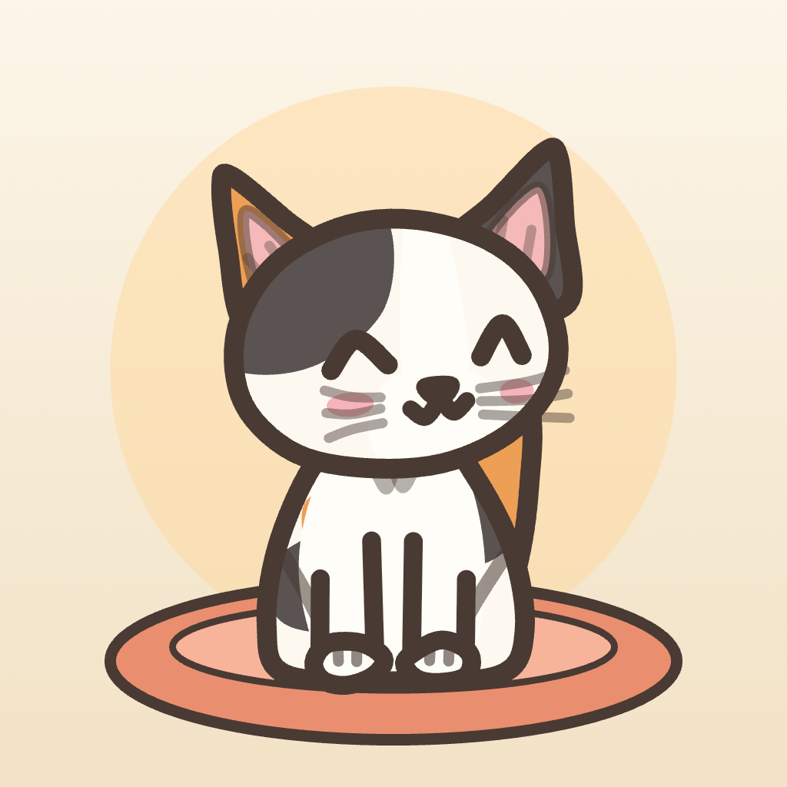<br>
  <sub>文中所有截图都来自真实运行的游戏。猫是代码画的，喜欢是真的。</sub>
</p>
